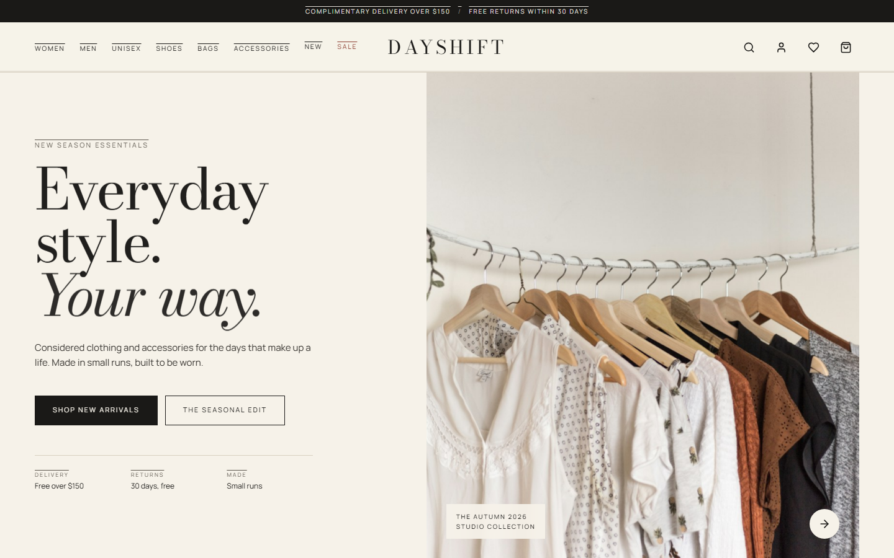
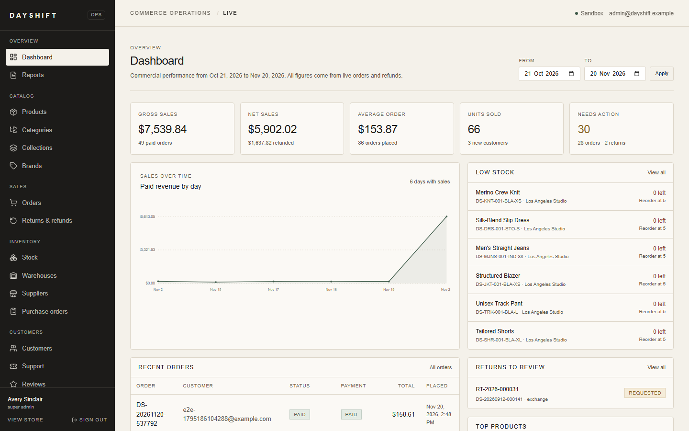
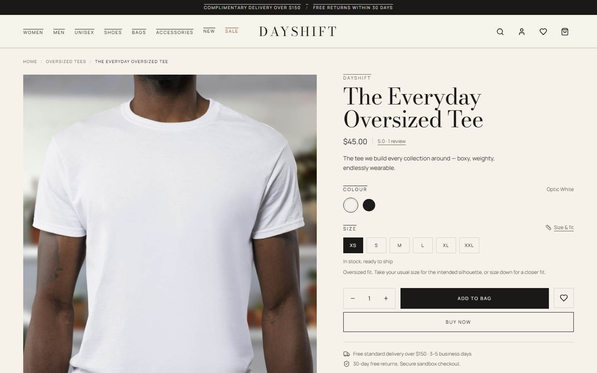
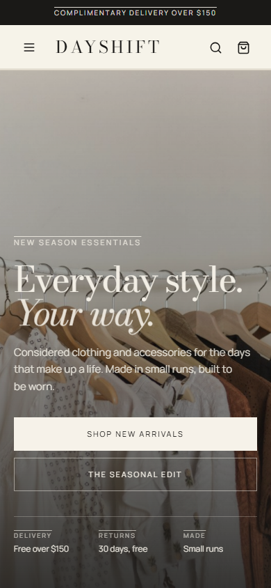

# DAYSHIFT

**Everyday style. Your way.**

DAYSHIFT is a full-stack fashion commerce platform: a customer storefront, a staff operations portal, a modular commerce API, transactional inventory, sandbox payments, background jobs and an auditable returns/refund/exchange workflow.

It is a working reference implementation built as a production-shaped monorepo. It is not a live shop: payments are simulated, product photography is licensed stand-in imagery from Unsplash, and email is written to local files.

> **Status:** portfolio/demo ready, running on a Windows LAN at `http://192.168.1.107:3000`. Not production ready — see [Production readiness](docs/PRODUCTION_READINESS.md) and the [independent audit](docs/INDEPENDENT_AUDIT_REPORT.md).

---

## Screenshots

| Storefront | Admin portal |
| --- | --- |
|  |  |

| Product detail | Mobile storefront |
| --- | --- |
|  |  |

All screenshots are captured from the running application at `192.168.1.107`. Additional views: [listing](docs/screenshots/storefront-listing.png), [cart](docs/screenshots/storefront-cart.png), [mobile product](docs/screenshots/storefront-mobile-product.png), [admin orders](docs/screenshots/admin-orders.png), [admin inventory](docs/screenshots/admin-inventory.png).

---

## Features

**Storefront**
Editorial home and collection pages, category/collection/search listings with URL-driven filters and sorting, product detail with colour and size variants, cart and wishlist, guest or account checkout, sandbox payment, order tracking, account dashboard, returns and exchanges, addresses, loyalty balance and support tickets.

**Operations portal**
Dashboard with live commercial metrics, catalogue management (products, variants, categories, collections, brands), multi-warehouse stock with transfers and movement history, suppliers and purchase orders, order fulfilment and shipments, returns and refunds, customers, support tickets, reviews, coupons, promotions, loyalty, staff and role permissions, audit log, sales reports, settings and system health.

**Platform**
Server-authoritative pricing in integer cents, atomic inventory reservations with expiry, HMAC-signed payment webhooks with event idempotency, serialised refunds, a controlled order state machine, permission-guarded API, structured error envelope with request IDs, Swagger in development, BullMQ worker, and a Playwright/Axe quality suite.

**Responsive and accessible**
The storefront is designed mobile-first and verified from **320px** upward: no horizontal overflow, 44px touch targets, full-screen menu and search, sticky add-to-bag and checkout bars, and dialogs that lock background scroll and close on Escape. Motion includes a sliding staggered menu, fades and lifts, with a full reduced-motion fallback. Axe reports zero serious or critical violations on six surfaces.

**SEO and answer-engine ready**
Per-page metadata and canonicals, Open Graph and Twitter cards, a 1200×630 social image, JSON-LD for Organization, WebSite/SearchAction, Product with offers and return policy, BreadcrumbList, ItemList and FAQPage, a dynamic 112-URL sitemap, AI-crawler-aware robots rules, and a generated `/llms.txt` summary. See [Storefront UX and SEO](docs/STOREFRONT_UX.md).

---

## Technology (verified)

| Layer | Technology |
| --- | --- |
| Storefront / admin | Next.js 15.5, React 19, TypeScript, Tailwind CSS 4 |
| API | NestJS 11, REST, class-validator, Swagger/OpenAPI |
| Data | PostgreSQL 16, Prisma 6, versioned migrations |
| Async | Redis 7, BullMQ 5 (email, reservation expiry, reconciliation) |
| Monorepo | pnpm 10 workspaces, Turborepo |
| Testing | Jest, Node integration/smoke suites, Playwright, Axe |
| Runtime | Node 22 container images, Docker Compose, GitHub Actions |

---

## Architecture

```
Browser (LAN)
   │
   ├── :3000  Next.js storefront ──┐
   ├── :3001  Next.js admin ───────┤  /api/* rewritten to the API
   │                               ▼
   │                        api:4000  NestJS
   │                         │      │
   │                  postgres:5432  redis:6379
   │                         ▲      ▲
   │                         └── worker (BullMQ)
   │
   └── :4000  API (direct, for diagnostics and Swagger in development)
```

Browser traffic only needs ports **3000**, **3001** and **4000**. PostgreSQL and Redis are bound to `127.0.0.1` on the host and are reachable only inside the Compose network. The browser apps call their own origin under `/api`, which Next rewrites to `http://api:4000` using Docker DNS.

Authentication uses an opaque session cookie hashed in PostgreSQL, a global session guard, and granular permission checks on every staff route. Checkout pricing, inventory reservation, payment state and refunds are decided by the server, never by the browser.

---

## Repository structure

```
apps/
  api/        NestJS commerce API (modules, guards, Prisma access)
  web/        Next.js storefront
  admin/      Next.js operations portal
  worker/     BullMQ background worker
packages/
  db/         Prisma schema, migrations, seed, shared inventory logic
  config/     Permissions, order state machine, pricing/shipping constants
  types/      Shared API contract types
  validation/ Shared Zod schemas
tests/e2e/    Playwright specs, Axe scan, screenshots
scripts/      setup, test suites, backup/restore, PowerShell operations
docs/         architecture, API, database, security, deployment, audit
infrastructure/docker/  Dockerfiles and PostgreSQL init
```

---

## Requirements

- **Docker deployment:** Docker Desktop with Compose v2 on Windows or macOS. No Node.js required on the host.
- **Local development:** Node.js 20+ (22 recommended), pnpm 10, Docker Desktop (or PostgreSQL 16 and Redis 7).
- **LAN access:** the host and client on the same private network, with the host firewall allowing the three application ports.

---

## Quick start (Docker, recommended)

```powershell
Copy-Item .env.example .env
# Set APP_URL/ADMIN_URL/NEXT_PUBLIC_SITE_URL to this machine's LAN address,
# SESSION_SECRET and PAYMENT_SANDBOX_SECRET to random values.
.\scripts\deploy.ps1
```

The deploy script builds the images, starts PostgreSQL, Redis, the API, worker, storefront and admin, waits for the API health check, applies the Windows Firewall rules, and verifies HTTP responses.

| Service | URL |
| --- | --- |
| Storefront | http://192.168.1.107:3000 |
| Admin portal | http://192.168.1.107:3001 |
| API | http://192.168.1.107:4000/api/v1 |
| API health | http://192.168.1.107:4000/api/v1/health |
| Swagger | development only, at `/api/docs` |

On macOS or Linux, the same stack runs with `docker compose --profile app up -d --build`; only the firewall step is Windows-specific.

Full instructions: [LAN deployment](docs/LAN_DEPLOYMENT.md) · [Docker deployment](docs/DOCKER_DEPLOYMENT.md).

---

## Local development

```bash
pnpm install
cp .env.example .env
node scripts/setup-env.mjs
docker compose up -d postgres redis
pnpm db:generate
pnpm build:packages
pnpm db:migrate
pnpm db:seed
pnpm dev
```

`pnpm dev` runs the API, storefront, admin and worker together. Ports are 3000 (storefront), 3001 (admin), 4000 (API), 5433 (PostgreSQL) and 6380 (Redis).

---

## Windows LAN deployment

1. Find the host IPv4 address: `Get-NetIPAddress -AddressFamily IPv4 | Where-Object { $_.IPAddress -notlike '127.*' }`.
2. Set `APP_URL`, `ADMIN_URL`, `API_URL` and `NEXT_PUBLIC_SITE_URL` in `.env` to that address.
3. Keep `COOKIE_SECURE=false` only while serving plain HTTP. Remove it, or set it to `true`, behind HTTPS.
4. Run `.\scripts\deploy.ps1` from an elevated PowerShell prompt.
5. Verify from another device: `curl http://<host-ip>:3000/api/v1/health`.

The script creates three inbound rules — TCP 3000, 3001 and 4000 — restricted to the **Private** profile and **LocalSubnet**. PostgreSQL and Redis are not opened to the LAN.

---

## macOS access

Open `http://192.168.1.107:3000` for the storefront and `http://192.168.1.107:3001` for the admin portal from Safari or Chrome on the same Wi-Fi/Ethernet network. No installation is required on the Mac.

If the page does not load, confirm the Mac is on the same subnet and that the Windows network profile is **Private**. macOS firewall settings do not affect outbound browser requests. See [LAN deployment](docs/LAN_DEPLOYMENT.md#macos-clients) for diagnostics.

> Cross-device verification from a physical Mac has not been performed for this release. The Windows host, Docker network and LAN-IP HTTP endpoints are verified; the Mac steps are documented but remain pending until tested on a Mac.

---

## Testing

```bash
pnpm typecheck                          # all apps and packages
pnpm lint
pnpm test                               # API unit tests
pnpm test:integration                   # returns, refunds, concurrency, RBAC, IDOR, XSS
pnpm test:exchange                      # exchange workflow
pnpm test:smoke                         # live API smoke
pnpm --filter @dayshift/e2e test        # Playwright purchase and admin flows
pnpm test:a11y                          # Axe scan of six surfaces
pnpm test:mobile                        # 320px and 390px overflow/tap-target audit
pnpm build                              # all production builds
pnpm audit:deps
```

Live suites target `http://localhost:4000` by default. Point them at the LAN deployment with `INTEGRATION_API`, `SMOKE_API`, `EXCHANGE_API`, `INTEGRATION_STOREFRONT`, `E2E_BASE_URL`, `E2E_ADMIN_URL` and `E2E_API_URL`.

Current results: typecheck 12/12, lint 7/7, unit 18/18, integration 18/18, exchange 8/8, smoke 24/24, Playwright 7/7, mobile audit 11 pages × 2 widths, Axe 0 serious/critical on six surfaces, all four production images built. Details: [TESTING.md](docs/TESTING.md) · [TEST_MATRIX.md](docs/TEST_MATRIX.md).

---

## Security

- Passwords hashed with bcrypt; session tokens stored only as SHA-256 hashes and revocable per device.
- Global authentication guard, granular permission checks, ownership validation on customer resources.
- Payment webhooks verified with HMAC over the raw body; duplicate event IDs are ignored.
- Refunds are serialised per order and cannot exceed captured payments.
- Cookies are `HttpOnly` and `SameSite=Lax`. The `Secure` flag defaults on in production and is disabled only by an explicit `COOKIE_SECURE=false` for plain-HTTP LAN demos.
- CORS and Origin checks are limited to the configured storefront and admin origins.
- PostgreSQL and Redis are not exposed beyond the host loopback interface.
- No secret is committed; `.env` files, logs, backups and mail output are git-ignored.

Residual risks and the full review: [SECURITY.md](docs/SECURITY.md) · [SECURITY_AUDIT_REPORT.md](docs/SECURITY_AUDIT_REPORT.md).

---

## Demo accounts

Demo data is seeded and all credentials are local-only. Do not reuse them anywhere.

| Role | Email | Password |
| --- | --- | --- |
| Customer (orders, returns, loyalty) | `customer@dayshift.example` | `Customer1234!Pass` |
| Customer | `james@example.com` | `Customer1234!Pass` |
| Super admin | `admin@dayshift.example` | `Admin1234!Pass` |
| Store manager | `manager@dayshift.example` | `Manager1234!Pass` |
| Warehouse staff | `warehouse@dayshift.example` | `Warehouse1234!Pass` |
| Customer support | `support@dayshift.example` | `Support1234!Pass` |
| Analyst | `analyst@dayshift.example` | `Analyst1234!Pass` |

Coupons: `WELCOME10`, `DAYSHIFT15`, `STYLE20`, `FLAT25`. Sandbox card: any test number such as `4242 4242 4242 4242`; no real payment is processed.

Suggested ten-minute walkthrough:

1. Storefront → New Arrivals → choose a size → add to bag.
2. Cart → apply a coupon → checkout as guest → pay with the sandbox card.
3. Admin → Orders → open the new order → advance status → create a shipment → add tracking events.
4. Inventory → adjust stock → inspect the movement history.
5. Returns → approve, receive, inspect and refund a delivered order.
6. Sign in as `warehouse@` or `support@` to see permission boundaries.

---

## Operational scripts

| Command | Purpose |
| --- | --- |
| `.\scripts\deploy.ps1` | Build and start the stack, configure firewall, verify HTTP |
| `.\scripts\stop.ps1` | Stop application containers (add `-All` for databases); volumes preserved |
| `.\scripts\status.ps1` | Git state, containers, endpoints and firewall rules |
| `.\scripts\logs.ps1 -Service api -Tail 100` | Container logs (`-Follow`, `-All`) |
| `.\scripts\health.ps1` | Strict container, HTTP and dependency checks; non-zero on failure |
| `.\scripts\backup.ps1` | Compressed `pg_dump` plus SHA-256 checksum into `backups/` |

All six scripts were executed against the running stack during this release. Restore remains explicit and destructive: `node scripts/db-restore.mjs <file> --yes`.

---

## Known limitations

- Payments, shipping and email are sandbox/local adapters; no real provider is integrated.
- Product photography is licensed stand-in imagery from Unsplash, not photographs of the actual demo inventory. See [image credits](docs/IMAGE_CREDITS.md).
- Single currency (USD) and a flat tax estimate; no jurisdiction engine.
- No MFA, CSP, file uploads, multi-currency or fraud engine.
- Loyalty is not reversed on refunds and coupon usage is not restored on cancellation — policy decision pending.
- Cash on delivery has no "cash collected" action.
- Reservation expiry and daily reconciliation are covered by code and unit-level checks, not observed across their real time windows.
- Search has no GIN index; in-process rate limiting; one API replica.
- CI is configured and validated locally but has not been executed on GitHub.
- Mac access is documented, not physically verified.

These are tracked in [Production readiness](docs/PRODUCTION_READINESS.md).

---

## Documentation

- [LAN deployment](docs/LAN_DEPLOYMENT.md)
- [Docker deployment](docs/DOCKER_DEPLOYMENT.md)
- [Architecture](docs/ARCHITECTURE.md)
- [Image credits and licences](docs/IMAGE_CREDITS.md)
- [Storefront UX, responsive rules and SEO/AEO](docs/STOREFRONT_UX.md)
- [API reference](docs/API.md)
- [Database](docs/DATABASE.md)
- [Business workflows](docs/BUSINESS_WORKFLOWS.md)
- [Environment variables](docs/ENVIRONMENT.md)
- [Testing](docs/TESTING.md) · [Test matrix](docs/TEST_MATRIX.md)
- [Operations](docs/OPERATIONS.md)
- [Security](docs/SECURITY.md) · [Security audit](docs/SECURITY_AUDIT_REPORT.md)
- [Production readiness](docs/PRODUCTION_READINESS.md)
- [Independent audit](docs/INDEPENDENT_AUDIT_REPORT.md) · [Remediation](docs/REMEDIATION_REPORT.md) · [Release verification](docs/RELEASE_VERIFICATION_REPORT.md)
- [Release report](docs/RELEASE_REPORT.md) (historical) · [GitHub release](docs/GITHUB_RELEASE.md) · [Final release report](docs/FINAL_RELEASE_REPORT.md)

---

## Project status

| Area | State |
| --- | --- |
| Storefront, admin, API, worker | Running in Docker on the Windows LAN |
| Database and Redis | Healthy; host ports bound to loopback |
| Automated tests | Typecheck, lint, unit, integration, exchange, smoke, E2E and Axe pass |
| Production builds | All four images build and start |
| Release tag | `v1.0.0` preserved |
| Production readiness | Not production ready; see the readiness document |

Demonstration project. Third-party photography is used under the [Unsplash License](https://unsplash.com/license); sources are listed in [IMAGE_CREDITS.md](docs/IMAGE_CREDITS.md).
