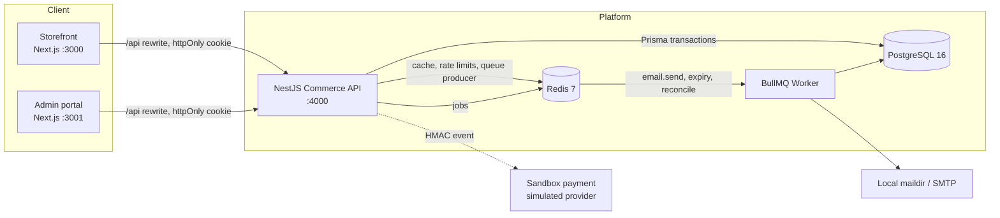
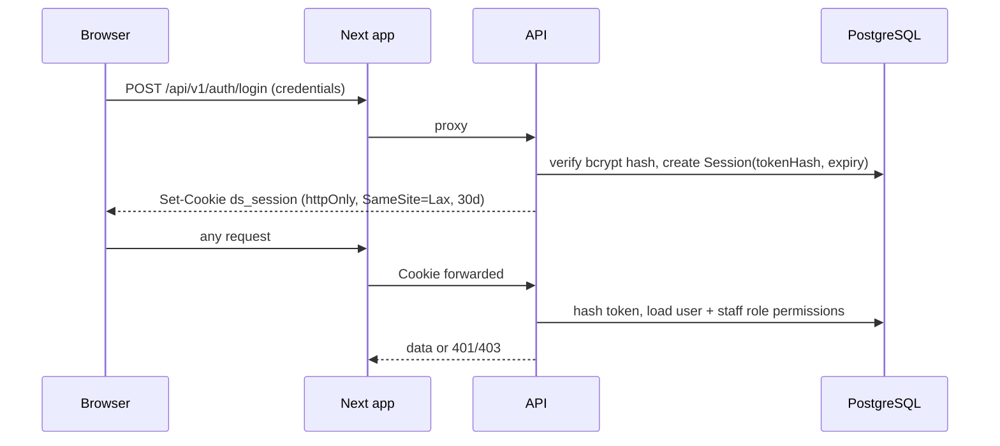
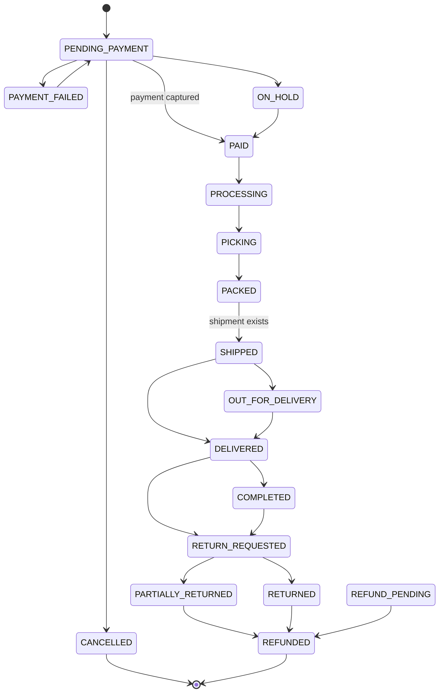
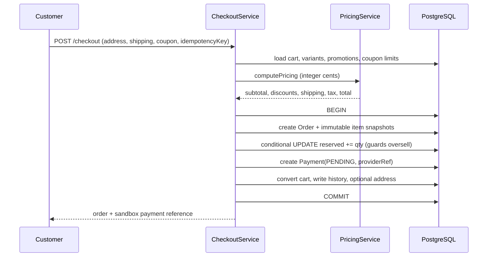

# Architecture

DAYSHIFT is a modular monolith. Four deployable applications share one PostgreSQL database and one Redis instance. Modules communicate through explicit services and database transactions rather than in-process shortcuts.

## System overview



Why a monolith: the business domains (catalogue, inventory, orders, returns) share strong transactional invariants. A modular monolith keeps stock and money changes atomic. Modules are separated by folder, service boundary and database ownership rules so a future extraction (e.g. search or notifications) is possible.

## Applications

| App | Responsibility | Trust boundary |
| --- | --- | --- |
| `apps/web` | Customer experience, server-rendered catalogue, client cart/checkout, account pages | Untrusted browser; never sends authoritative prices |
| `apps/admin` | Staff operations, dense tables, controlled actions | Staff session + granular permissions enforced by API |
| `apps/api` | All business rules, validation, pricing, stock, payments, authorization | Authority |
| `apps/worker` | Email delivery, reservation expiry, payment reconciliation | Trusted background process |

Both Next apps proxy `/api/:path*` to the API through Next rewrites, so browser requests and cookies are same-origin in development and production.

## API module map

```
auth            sessions, registration, reset, staff login, profile
catalog         categories, collections, brands, products, facets, search
cart            guest/account carts, merge, coupons, live totals
wishlist        saved products and move-to-cart
pricing         single authoritative pricing engine
checkout        quote, order creation, stock reservation, payment intent
payments        sandbox confirmation, signed webhooks, refunds, reconciliation
orders          customer orders, state machine, shipments, returns
inventory       reservations, commit/release, adjust, transfer, alerts, expiry
loyalty         earn/redeem, tiers, history
reviews         verified purchase checks, moderation, helpful votes
support         tickets, customer replies, internal notes
content         home content, navigation, public settings, sitemap, newsletter
account         profile-adjacent data, addresses, notifications, export
admin           dashboard, catalogue CRUD, operations, CRM, marketing, system
health          liveness and queue/memory detail
```

## Authentication and authorization



- Opaque session tokens, SHA-256 hashed at rest, revocable individually.
- Global `SessionAuthGuard`: every route is protected unless explicitly `@Public()`.
- Staff routes add `PermissionsGuard` with `@RequirePermissions(...)`; role permissions are seeded and editable.
- Customer data is scoped by `userId` in every query. Guest order lookup requires order number **and** email.
- CSRF: SameSite cookies plus an Origin allow-list for mutating browser requests. Webhooks are server-to-server and HMAC-verified.
- Login throttling: IP throttler plus per-email/IP failure counters in Redis (6 attempts / 15 minutes).

## Order lifecycle



Valid transitions live in `packages/config/src/order-state.ts`; the service rejects anything else. Every transition writes `OrderStatusHistory` with actor, reason and metadata. `CANCELLED` and `REFUNDED` are terminal.

## Checkout and pricing flow



The browser sends no prices. `computePricing` is a pure function with unit tests. A conditional `UPDATE … WHERE onHand - reserved - damaged >= qty` is the concurrency guard: the second of two simultaneous checkouts affects zero rows and its transaction aborts.

## Inventory lifecycle

- `available = onHand − reserved − damaged` per warehouse.
- Checkout reserves for 15 minutes (configurable) across warehouses.
- Payment success commits: `onHand −= qty`, `reserved −= qty`, movement `SALE`.
- Payment failure or cancellation releases reservations.
- Worker runs `reserve.expire` every minute; expired `PENDING_PAYMENT` orders are cancelled and payment attempts voided.
- Returns never restock until inspection; exchanges check replacement stock at approval and consume it at inspection.
- Every `onHand` change writes `InventoryMovement` with previous/new balance, reason, reference and actor.

## Payment lifecycle

1. Checkout creates a `Payment` with a random `providerRef` and amount equal to the order total.
2. The storefront's sandbox screen calls `/payments/sandbox/confirm`; ownership is checked (account or order email).
3. The API simulates a provider event and processes it through the same path as a webhook.
4. Webhooks require `x-dayshift-signature = HMAC-SHA256(rawBody, PAYMENT_SANDBOX_SECRET)`.
5. `PaymentEvent.eventId` is unique: duplicates return `{duplicate:true}` and never re-deduct stock or re-award points.
6. Success: payment paid → order paid → inventory commit → coupon redemption → loyalty accrual → confirmation email (queued).
7. Refunds are staff-only, capped by paid minus already-refunded, and produce an auditable `Refund` + `RefundItem` records.

## Background jobs

| Job | Schedule | Behaviour |
| --- | --- | --- |
| `email.send` | on demand | Sends a queued notification, marks SENT/FAILED, retries with exponential backoff |
| `email.retry` | every 5 min + on worker boot | Re-attempts PENDING/FAILED notifications older than 2 min |
| `reservation.expire` | every 60 s | Releases expired reservations, cancels unpaid orders |
| `payment.reconcile` | daily | Recomputes `paymentStatus` from payments and processed refunds |

Jobs use `jobId`/dedupe keys where replay would be harmful. Failed jobs remain in Redis with five attempts.

## Error handling and observability

- Every response carries `X-Request-Id`; errors return `{statusCode, code, message, requestId}`.
- Prisma constraint errors are mapped to 409/404 without leaking SQL.
- Unexpected errors are logged server-side; stack traces are never returned.
- `/health` checks database and Redis; `/admin/system` exposes queue counts, memory, uptime and failed notifications.
- Audit entries record staff actions, actor, IP/user agent, before/after payloads.

## Storefront rendering strategy

Catalogue and product pages are dynamic (`force-dynamic`) because price and inventory must be current. Account pages are dynamic and cookie-scoped. Shared category/collection caches (Redis, 5 minutes) are invalidated by admin mutations; pricing settings cache 2 minutes. The cart badge loads client-side so browsing does not create guest carts server-side.

## Deliberate boundaries

- No microservices: transactional consistency outweighs independent scaling at this stage.
- No AI recommendations: recommendations are explainable “related category / same collection” rules.
- No third-party payment, shipping or email credentials are assumed. Providers are explicit sandbox implementations.
