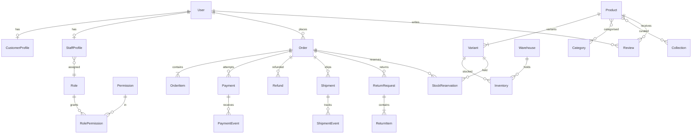

# Database

PostgreSQL 16 with Prisma ORM. Schema: `packages/db/prisma/schema.prisma`. Migrations: `packages/db/prisma/migrations/`.

## Entity groups

| Group | Tables |
| --- | --- |
| Identity | `User`, `CustomerProfile`, `StaffProfile`, `Role`, `Permission`, `RolePermission`, `Session`, `PasswordResetToken`, `EmailVerificationToken`, `Address` |
| Catalogue | `Category` (self-referencing tree), `Brand`, `Collection`, `Product`, `ProductImage`, `ProductCategory`, `ProductCollection`, `Variant`, `SizeGuide` |
| Inventory | `Warehouse`, `Inventory`, `InventoryMovement`, `StockReservation` |
| Cart | `Cart`, `CartItem`, `Wishlist`, `WishlistItem` |
| Promotions | `Coupon`, `CouponCategory`, `CouponProduct`, `CouponProductCollection`, `CouponRedemption`, `Promotion` |
| Orders | `Order`, `OrderItem`, `OrderStatusHistory`, `Payment`, `PaymentEvent`, `Refund`, `RefundItem`, `Shipment`, `ShipmentEvent` |
| Returns | `ReturnRequest`, `ReturnItem` |
| Engagement | `Review`, `ReviewVote`, `SupportTicket`, `TicketMessage`, `LoyaltyAccount`, `LoyaltyTransaction`, `Notification` |
| Content | `ContentBlock`, `NavigationItem`, `NewsletterSubscriber`, `Setting` |
| Purchasing | `Supplier`, `PurchaseOrder`, `PurchaseOrderItem` |
| Governance | `AuditLog` |



## Key constraints and indexes

- `User.email`, `Product.slug`, `Product.sku`, `Variant.sku`, `Variant.barcode`, `Category.slug`, `Collection.slug`, `Brand.slug`, `Coupon.code`, `Order.orderNumber`, `Order.idempotencyKey`, `Payment.providerRef`, `PaymentEvent.eventId`, `ReturnRequest.returnNumber`, `SupportTicket.ticketNumber`, `StockReservation.token`-style uniqueness.
- `Variant @@unique([productId, size, color])`; variants must use non-null `size` (one-size is `One Size`) so combination uniqueness is meaningful.
- `Inventory @@unique([variantId, warehouseId])`; `StockReservation` indexed by `(status, expiresAt)`, `(variantId, status)`.
- `Order` indexed by `(userId)`, `(status, createdAt)`, `(paymentStatus)`, `(email)`, `(createdAt)`.
- `OrderItem` keeps product name/slug/SKU/size/colour/image/price snapshots; `variantId` is nullable with `SetNull` so historical orders survive catalogue deletion.
- Financial records (`Order`, `OrderItem`, `Payment`, `PaymentEvent`, `Refund`, `RefundItem`, `ReturnRequest`) use `Restrict` deletion policies. Catalogue deletions cascade only to join/media rows.
- `Review @@unique([productId, userId])` prevents duplicate reviews.
- Manual inventory changes are append-only; there is no API that deletes a movement.

## Money

All money is `Decimal(12,2)` in PostgreSQL. The API serialises to two-decimal strings. The pricing engine converts to integer cents, performs all arithmetic in integers, and returns cents and formatted strings. No floating-point value is authoritative.

## Inventory accounting

```
available(variant, warehouse) = on_hand - reserved - damaged
available(variant)            = Σ available across active warehouses
```

Safety stock and reorder point are advisory; they drive low-stock alerts and do not remove units from sale. Reservations and commits use conditional SQL `UPDATE` statements so two transactions cannot reserve the same unit.

## Transactions

- Checkout: order + items + reservations + payment + cart conversion in one transaction.
- Payment success: payment, order status, inventory commit, coupon redemption, loyalty in one transaction; notifications afterwards.
- Inspection: return status, order item returned quantity, order status, restock and exchange consumption.
- Refund: refund + items + payment/order status update.
- Adjustments/transfers: inventory + movement + audit.

## Migrations and seed

```bash
pnpm db:migrate                               # development
pnpm db:deploy                                # production, applies committed migrations
pnpm db:seed                                  # safe seed; SEED_RESET=1 rebuilds demo data
```

Seed creates 40 products, 365 variants, 2 warehouses, 40+ categories, 6 collections, 3 brands, 8 users, 7+ demo orders, returns, tickets, reviews, coupons, promotions, suppliers and POs. `SEED_RESET=1` deletes demo data only; it refuses to run in production.

## Backup and restore

```bash
pnpm db:backup
node scripts/db-restore.mjs backups/<file>.sql --yes
```

Backups use `pg_dump` inside the Docker container and persist to `backups/`. Restore requires `--yes` because it overwrites the target database. Test restore on a non-production copy before relying on it.
